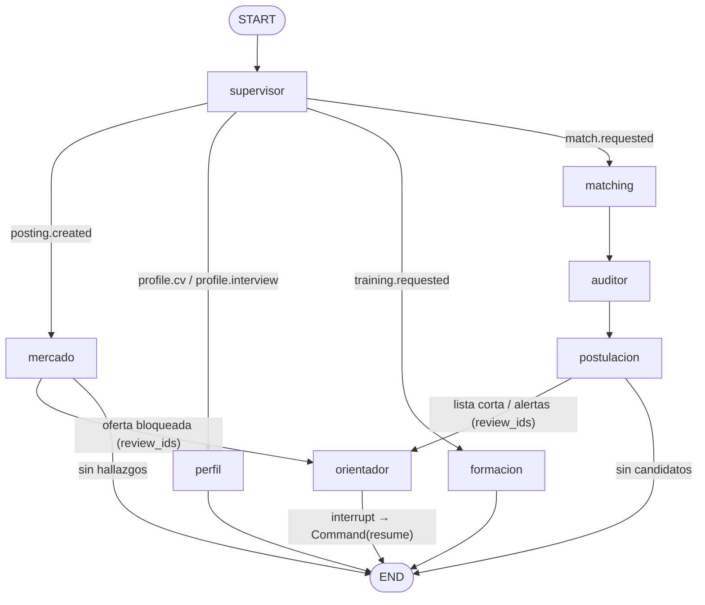

Todo pasa por un único grafo compilado (`graph/supervisor.py`). Un endpoint dispara un **evento**, el supervisor lo enruta con reglas fijas al agente que toca y, si algún nodo deja revisiones humanas pendientes, el grafo se pausa en el nodo `orientador` hasta que el orientador decide.

## Eventos y rutas

| Evento | Endpoint que lo dispara | Ruta |
|---|---|---|
| `posting.created` | `POST /postings` | `mercado` → (`orientador`) |
| `profile.cv` | `POST /youth/{youthId}/cv` | `perfil` |
| `profile.interview` | `POST /youth/{youthId}/interview` | `perfil` (hilo fijo `entrevista-<youthId>`) |
| `match.requested` | `POST /match-runs` | `matching` → `auditor` → `postulacion` → (`orientador`) |
| `training.requested` | `POST /youth/{youthId}/training-plan` | `formacion` |

El supervisor no usa LLM: es el diccionario `ROUTES`. Un evento sin ruta lanza `ValueError`. Las aristas condicionales `_review_or_end` mandan a `orientador` solo si el estado trae `review_ids`.

## Estado y dependencias

`PuenteState` (`graph/state.py`) solo lleva datos **serializables**, porque el checkpointer lo guarda en cada paso: `thread_id`, `event`, `payload`, `route`, `result`, y para el matching `run_id`, `youth_ids`, `posting_ids`, `matching_result` y `review_ids`.

La sesión de BD, el `LLMClient` y el `thread_id` viajan en `config["configurable"]` y se leen con `deps(config)`. Nunca metas una sesión u objeto vivo en el estado.

## Runner y transacciones

`graph/runner.py` envuelve cada ejecución:

- `run(session, llm, event, payload, thread_id=None)` invoca el grafo y hace `commit`. Si el grafo llega a `interrupt`, devuelve lo hecho hasta ahí confirmado y `result["awaiting_review"] = True`.
- Si un nodo falla: `rollback`, una fila de traza `kind="error"` (o `kind="guardrail"` si fue `GuardrailBlocked`), `commit` de esa traza y relanza la excepción. Así la traza existe también ante errores.
- `is_paused(thread_id)` mira `snapshot.next` del checkpoint.
- `resume(session, llm, thread_id, decisions)` reanuda con `Command(resume=decisions)`.

## HITL: interrupt y reanudación

1. Mercado (oferta bloqueada), Auditor (alerta de sesgo) y Postulación (lista corta) crean filas `review_task` con `graph_thread_id` y dejan sus ids en `review_ids`.
2. El nodo `orientador` deja una traza `pausa_hitl` (una sola vez por conjunto de revisiones) y llama a `interrupt(...)`. Antes del `interrupt` no hay efectos secundarios, porque LangGraph **vuelve a ejecutar el nodo desde el inicio** al reanudar.
3. `POST /reviews/{reviewId}/decision` valida la decisión (`graph/hitl.py`), la guarda en `proposal.decision` y, si el hilo aún tiene revisiones `pendiente`, solo hace commit.
4. Cuando ya no quedan pendientes, junta las decisiones del hilo y llama a `runner.resume`. Si el hilo no tiene checkpoint (datos previos al HITL), aplica los efectos sin grafo con `apply_reviews`.
5. Al reanudar, `apply_reviews` aplica en orden `alerta_sesgo` → `bloqueo_oferta` → `lista_corta` (`KIND_ORDER`) y escribe una traza `decision_humana` por revisión.

Detalle de cada decisión en [Orientador (HITL)](/docs/agentes/orientador).

## Checkpointer

`graph/checkpoint.py`: con SQLite en archivo, los checkpoints viven en un archivo hermano `<db>-checkpoints.sqlite` (`SqliteSaver`), así que **una pausa sobrevive a reiniciar la API**. Con SQLite en memoria (tests) u otro motor se usa `InMemorySaver`. Para Postgres basta cambiar esta función por `langgraph-checkpoint-postgres`, sin tocar el grafo.

El grafo compilado es único por proceso (`get_graph` con `lru_cache`).

## Trazas (`agent_trace`)

Cada nodo escribe una fila con `traced(...)` (`tracing.py`): agente, paso, entrada y salida resumidas (máx. 500 caracteres), herramienta, decisión, razón y duración. Tipos (`kind`): `paso`, `pausa_hitl`, `decision_humana`, `guardrail`, `error`. Si el nodo usó el LLM, la traza añade qué modelo respondió y si se cayó al valor por defecto («se usó el valor por defecto seguro»).

`GET /traces` lista hilos recientes con su estado; `GET /traces/{threadId}` devuelve la línea de tiempo que muestra la web en `/traza/[threadId]`. Langfuse es un complemento opcional (`llm/observability.py`).
