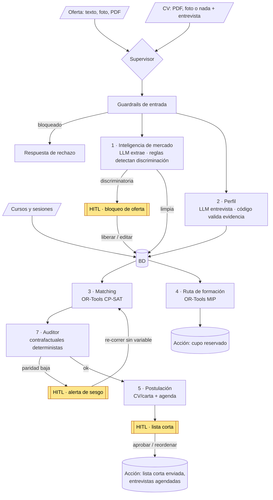
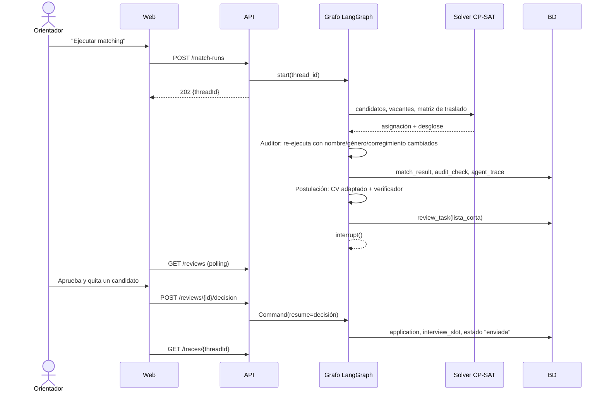
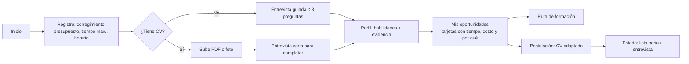
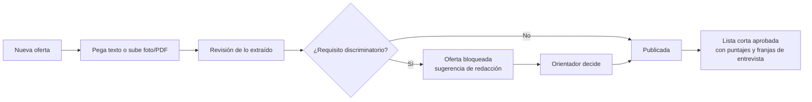
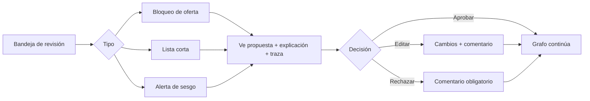

# 03 · App flow — Puente

Flujos por actor, grafo de agentes y mapa de pantallas. Canal único: **web app** (`apps/web`).

## 1. Arquitectura de agentes y punto de intervención humana

Este es el diagrama de arquitectura que pide el reto: agentes, herramientas, flujos y HITL.

Todas las cajas escriben en `agent_trace` y en Langfuse.

## 2. Secuencia de una corrida de matching

## 3. Flujos por actor

### 3.1 Joven

### 3.2 Empresa

### 3.3 Orientador (HITL)

### 3.4 Centro de formación
Registro de centro → alta de cursos con habilidades y sesiones (cupos, horario) → vista de inscritos sugeridos por la ruta de formación.

## 4. Mapa de pantallas

| Ruta | Actor | Contenido |
|---|---|---|
| `/` | Todos | Selector de rol (demo) |
| `/joven/registro` | Joven | Datos de traslado, presupuesto, horario |
| `/joven/perfil` | Joven | Subir CV, entrevista, habilidades con evidencia |
| `/joven/oportunidades` | Joven | Tarjetas de match con desglose |
| `/joven/formacion` | Joven | Ruta de formación |
| `/joven/postulaciones` | Joven | Estado y entrevistas |
| `/empresa/ofertas/nueva` | Empresa | Ingesta de oferta |
| `/empresa/ofertas/[id]` | Empresa | Detalle, hallazgos, lista corta |
| `/centro/cursos` | Centro | Cursos y sesiones |
| `/orientador` | Orientador | Bandeja de revisión |
| `/orientador/revision/[id]` | Orientador | Detalle de decisión + traza |
| `/orientador/corridas/[id]` | Orientador | Resultado de matching y auditoría |
| `/trazas/[threadId]` | Orientador / jurado | Línea de tiempo por agente |

Estados por pantalla: **vacío** (con acción siguiente), **procesando** (agente activo mostrado por nombre), **esperando revisión**, **error** (mensaje en español y reintento), **bloqueado por guardrail** (razón visible).
