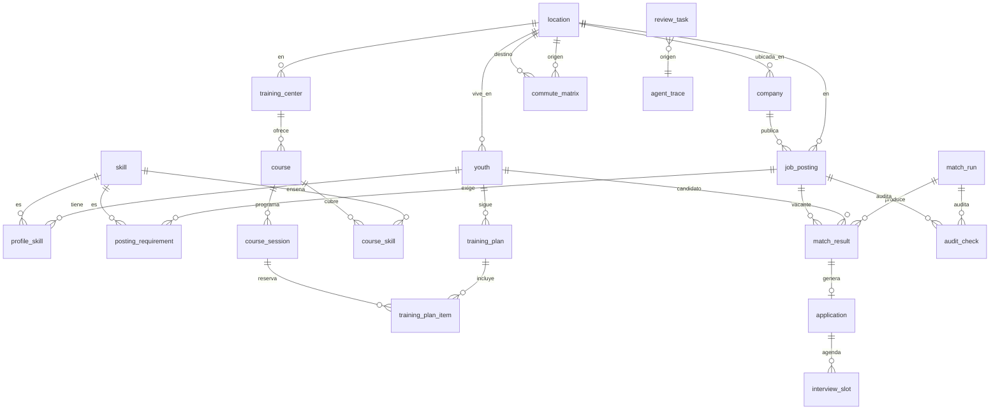

# 05 · Esquema del backend — Puente

Modelo de datos y superficie de la API. El contrato completo es [`packages/api-spec/openapi.yaml`](../packages/api-spec/openapi.yaml) (OpenAPI 3.1, fuente de verdad), visible con Scalar:

```bash
pnpm api:docs
```

(abre `http://localhost:4010`). En ejecución, FastAPI también sirve Scalar en `http://localhost:8000/docs`.

## 1. Diagrama entidad-relación



## 2. Tablas

Convenciones: `id` UUID, `created_at`/`updated_at` timestamptz, dinero en balboas como `numeric(8,2)`, tiempos en minutos (`int`), horarios como `jsonb` de franjas `{dia, inicio, fin}`.

### Catálogos
| Tabla | Columnas clave | Notas |
|---|---|---|
| `location` | `id`, `corregimiento`, `distrito`, `provincia`, `lat`, `lng` | Seed oficial |
| `commute_matrix` | `origin_id`, `dest_id`, `minutes`, `cost_daily`, `mode` (`bus`/`metro`/`mixto`) | PK compuesta; precomputada |
| `skill` | `id`, `esco_uri`, `label_es`, `group`, `aliases[]` | ESCO-lite |

### Lado joven
| Tabla | Columnas clave | Notas |
|---|---|---|
| `youth` | `id`, `display_name`, `birth_year`, `gender` (opcional), `location_id`, `max_commute_min`, `transport_budget_daily`, `availability` jsonb, `min_salary`, `studying` bool, `cv_raw_text`, `is_synthetic` | `display_name`/`gender` nunca entran al solver |
| `profile_skill` | `youth_id`, `skill_id`, `level` (1–3), `source` (`cv`/`entrevista`/`orientador`), `evidence` text | `evidence` obligatoria |
| `interview_turn` | `youth_id`, `idx`, `question`, `answer` | Entrevista de perfil |

### Lado empresa
| Tabla | Columnas clave | Notas |
|---|---|---|
| `company` | `id`, `name`, `location_id`, `contact_email` | |
| `job_posting` | `id`, `company_id`, `title`, `raw_input`, `input_type` (`texto`/`foto`/`pdf`), `location_id`, `schedule` jsonb, `salary_min`, `salary_max`, `vacancies`, `status` (`borrador`/`bloqueada`/`publicada`/`cerrada`) | |
| `posting_requirement` | `posting_id`, `skill_id`, `weight` (1–3), `required` bool | |

### Lado formación
| Tabla | Columnas clave | Notas |
|---|---|---|
| `training_center` | `id`, `name`, `location_id` | |
| `course` | `id`, `center_id`, `title`, `hours`, `cost` | |
| `course_skill` | `course_id`, `skill_id` | |
| `course_session` | `id`, `course_id`, `schedule` jsonb, `start_date`, `seats_total`, `seats_taken` | `CHECK seats_taken <= seats_total` |

### Decisiones de agentes
| Tabla | Columnas clave | Notas |
|---|---|---|
| `match_run` | `id`, `triggered_by`, `params` jsonb, `solver_status`, `solve_ms`, `graph_thread_id` | |
| `match_result` | `run_id`, `youth_id`, `posting_id`, `score`, `score_breakdown` jsonb, `constraints_checked` jsonb, `explanation`, `status` (`propuesto`/`aprobado`/`rechazado`) | Único (`run_id`,`youth_id`,`posting_id`) |
| `training_plan` | `id`, `youth_id`, `total_cost`, `unlocked_postings` int, `explanation`, `status` | |
| `training_plan_item` | `plan_id`, `session_id`, `order` | |
| `application` | `id`, `match_result_id`, `tailored_cv`, `cover_letter`, `status` (`en_lista_corta`/`enviada`/`entrevista`/`descartada`) | |
| `interview_slot` | `id`, `application_id`, `starts_at`, `ends_at`, `status` | Sin solapes por joven |
| `audit_check` | `id`, `run_id` o `posting_id`, `kind` (`discriminacion`/`contrafactual`), `variable` (`nombre`/`genero`/`corregimiento`), `parity`, `findings` jsonb, `passed` bool | |
| `review_task` | `id`, `kind` (`bloqueo_oferta`/`lista_corta`/`alerta_sesgo`), `subject_id`, `proposal` jsonb, `explanation`, `status` (`pendiente`/`aprobada`/`editada`/`rechazada`), `reviewer`, `comment`, `graph_thread_id`, `resolved_at` | Punto HITL |
| `agent_trace` | `id`, `thread_id`, `agent`, `step`, `input_summary`, `decision`, `reason`, `duration_ms`, `langfuse_trace_id`, `created_at` | Índice (`thread_id`,`created_at`) |
| `eval_case` / `eval_result` | `case_id`, `group`, `input`, `expected`, `metric`, `value`, `passed`, `run_at` | Resultados de evals |

### Índices
- `job_posting(status)`, `match_result(run_id, score desc)`, `review_task(status, created_at)`, `profile_skill(skill_id)`, `posting_requirement(skill_id)`.

## 3. Datos semilla (demo)
- ~60 corregimientos (Panamá, Panamá Oeste, San Miguelito) con matriz de traslado completa entre ellos.
- 150 habilidades ESCO-lite.
- 25 ofertas reales normalizadas (≥ 3 con requisitos discriminatorios para el demo).
- 12 cursos INADEH con 1–3 sesiones.
- 40 jóvenes sintéticos (incluida la persona "Ana").

## 4. API REST (resumen)

Base: `/api/v1`. Errores con `application/problem+json`.

| Método | Ruta | Descripción | Agente / acción |
|---|---|---|---|
| GET | `/health` | Estado | — |
| POST | `/youth` | Crear joven | — |
| GET | `/youth/{id}` | Perfil con habilidades | — |
| POST | `/youth/{id}/cv` | Subir CV (PDF/foto/texto) | Perfil |
| POST | `/youth/{id}/interview` | Enviar respuesta y obtener siguiente pregunta | Perfil |
| GET | `/youth/{id}/matches` | Matches aprobados/propuestos | — |
| POST | `/youth/{id}/training-plan` | Calcular ruta de formación | Ruta de formación |
| POST | `/companies` | Crear empresa | — |
| POST | `/postings` | Ingerir oferta (texto/foto/PDF) | Mercado + Auditor |
| GET | `/postings` | Listar ofertas (filtro por estado) | — |
| GET | `/postings/{id}` | Detalle con requisitos y hallazgos | — |
| GET | `/postings/{id}/shortlist` | Lista corta aprobada | — |
| POST | `/training-centers` | Crear centro | — |
| POST | `/courses` | Crear curso con sesiones | — |
| POST | `/match-runs` | Ejecutar matching | Matching → Auditor → Postulación |
| GET | `/match-runs/{id}` | Resultado y auditoría | — |
| GET | `/reviews` | Bandeja del orientador | — |
| POST | `/reviews/{id}/decision` | Aprobar / editar / rechazar | Reanuda el grafo |
| GET | `/traces/{threadId}` | Línea de tiempo de agentes | — |
| GET | `/locations` | Corregimientos | — |
| GET | `/skills` | Taxonomía | — |

Las operaciones que disparan agentes responden `202 Accepted` con `thread_id`; el cliente consulta `/traces/{threadId}` y `/reviews`.
