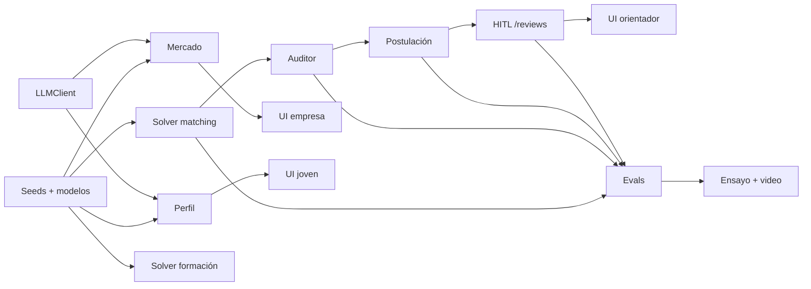

# 06 · Plan de implementación — Puente

Plan para las 24 horas, organizado por paquete del monorepo. Referencias: [PRD](01-prd.md), [TRD](02-requerimientos-tecnicos.md), [esquema](05-esquema-backend.md), [contrato OpenAPI](../packages/api-spec/openapi.yaml).

## 1. Responsables

| Persona | Área principal | Paquetes |
|---|---|---|
| José Vásquez (@devoncats) | Grafo de agentes, LLM, HITL, trazas | `apps/api/graph`, `llm`, `tracing` |
| Sebastian Olivera (@sebolive386) | Datos, solvers, evals, guardrails | `apps/api/solvers`, `db/seed`, `tests/evals`, `guardrails` |
| Kenneth Zhong (@Xyryung) | Web, diseño, demo | `apps/web`, `packages/ui`, video |

Todos: mantener `packages/api-spec/openapi.yaml` como contrato; cualquier cambio de endpoint se hace primero ahí.

## 2. Bloques horarios

| Horas | José (agentes) | Sebastian (datos/solvers) | Kenneth (web) | Hito y criterio de hecho |
|---|---|---|---|---|
| 0–1 | Repo registrado, ramas, `.env` | Repo, recolección de ofertas | `pnpm install`, `pnpm dev` | **H0:** repo registrado, monorepo corre |
| 1–4 | FastAPI + modelos SQLAlchemy + `LLMClient` (LiteLLM) | Seeds: corregimientos, matriz de traslado, ESCO-lite, 25 ofertas, 12 cursos, 40 jóvenes | Layout, selector de rol, cliente tipado desde OpenAPI (`openapi-typescript`) | **H1:** `GET /locations`, `/skills`, `/postings` sirven datos semilla |
| 4–8 | Agentes Mercado y Perfil + supervisor + `agent_trace` | Solver de matching CP-SAT + tests unitarios de restricciones | Pantallas empresa (ingesta) y joven (perfil, entrevista) | **H2:** oferta ingresada y perfil generado de punta a punta |
| 8–12 | Agente Postulación + `interrupt` HITL + `/reviews` | Auditor contrafactual + reglas de discriminación + solver de formación | Bandeja del orientador + tarjetas de oportunidad | **H3:** corrida completa con pausa y reanudación HITL |
| 12–14 | Descanso escalonado / buffer | | | |
| 14–17 | Langfuse + `/traces` | Guardrails + 20 casos de eval | Pantalla de traza + ruta de formación | **H4:** evals corriendo, traza visible |
| 17–20 | Endurecer errores, reintentos LLM | Ajuste de métricas, `results.md` | Pulido visual, estados vacío/error | **H5: congelar features** |
| 20–22 | Docker Compose, README técnico | Bitácora de IA, documento de metodología | Ensayo del guion, grabación del video | **H6:** demo ensayado 2 veces |
| 22–24 | Corrección de bugs del ensayo | Revisión de entregables | Edición del video ≤ 3 min | **H7:** tag `final-24h` |

## 3. Puntos de corte de alcance

Si a la hora indicada no se cumple el hito, se recorta en este orden:

1. **H2 tarde:** la entrada por foto se limita a PDF/texto (visión queda como stretch).
2. **H3 tarde:** la ruta de formación pasa de MIP a greedy determinista con la misma interfaz.
3. **H4 tarde:** Langfuse se omite; queda solo `agent_trace` propia (cumple trazabilidad).
4. Nunca se recorta: matching con solver, HITL, auditor, guardrails y ≥ 15 evals (son requisitos mínimos).

## 4. Orden de dependencias

## 5. Convenciones de trabajo

- Ramas cortas `feat/<area>-<tema>`, PR pequeño a `main`, commits frecuentes (el reto revisa la actividad durante el periodo).
- Comandos:
  - `pnpm dev` levanta web (3001) y API (8000) vía Turborepo.
  - `pnpm api:lint` valida el contrato; `pnpm api:docs` abre Scalar (4010).
  - `pnpm --filter api test` y `pnpm --filter api evals`.
  - `pnpm check` (Biome) antes de cada PR.
- Todo uso de IA se anota en la **Bitácora de IA** del README (qué, con qué herramienta, qué se cambió a mano).

## 6. Checklist de entregables (hora 24)

- [ ] Repositorio en GitHub registrado en la hora 1, con commits durante el periodo.
- [ ] Tag `final-24h` sobre el último commit válido.
- [ ] README: problema, arquitectura, tecnologías, fuentes de datos, instalación, ejecución, credenciales de demo (`.env.example`).
- [ ] Diagrama de arquitectura (agentes, herramientas, flujos, HITL) — [03-app-flow.md §1](03-app-flow.md).
- [ ] Evals: ≥ 15 casos, métrica y resultados.
- [ ] Bitácora de IA.
- [ ] Documento de metodología (despliegue, funcionamiento, arquitectura).
- [ ] Video demo ≤ 3 min.

## 7. Riesgos y mitigaciones

| Riesgo | Probabilidad | Mitigación |
|---|---|---|
| Pocos datos reales | Media | Seeds sintéticos marcados `is_synthetic`; ofertas reales mínimas para el demo |
| Solver lento o INFEASIBLE | Media | Límite de tiempo, holguras penalizadas, tamaño acotado en demo |
| Proveedor LLM caído o con rate limit | Media | LiteLLM con modelo de respaldo; caché de respuestas en evals y demo |
| Salida LLM mal formada | Alta | Pydantic + reintento + valores por defecto seguros |
| Integración web–API tardía | Media | Contrato OpenAPI desde la hora 1; mocks con datos del contrato |
| Demo en vivo falla | Baja | Video de respaldo y base de datos con estado precargado |
| Agotamiento del equipo | Alta | Descanso escalonado horas 12–14; congelar features en H5 |
